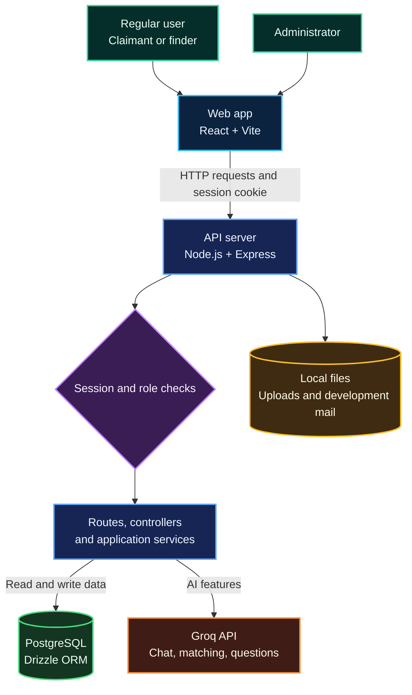

# Athar — Lost & Found Platform

Athar is a bilingual lost-and-found web application. People can report missing belongings, post found items, review AI-suggested matches, submit ownership claims, and coordinate a handover through in-app conversations.

The project uses a React frontend, a Node.js/Express API, PostgreSQL with Drizzle ORM, and Groq-hosted language and vision models. AI helps people review information; it does not make the final ownership decision.

## Contents

- [What it does](#what-it-does)
- [Roles and capabilities](#roles-and-capabilities)
- [Architecture](#architecture)
- [AI and matching flow](#ai-and-matching-flow)
- [Technology](#technology)
- [Project layout](#project-layout)
- [Run locally](#run-locally)
- [Environment variables](#environment-variables)
- [API overview](#api-overview)

## What it does

- Create and manage lost-item reports and found-item posts.
- Browse public reports and found items.
- Compare possible matches using descriptions, item type, location, and available photos.
- Ask Athar AI about reports and possible matches in Arabic or English.
- Submit an ownership claim by answering AI-generated questions.
- Message the other person and coordinate a handover.

## Roles and capabilities

### Regular users: owners and finders

A regular account can take part in the community as either a person who lost an item or a person who found one. The account can:

- Create, update, and manage its lost reports and found-item posts.
- Browse public lost reports and found items.
- Review AI-suggested matches and ask the Athar AI assistant about them.
- Submit an ownership claim and answer questions prepared from the found-item photo.
- Share supporting photos or receipts with a claim.
- Continue the claim conversation, respond to a decision, and confirm or dispute a handover.

The finder reviews the claimant's answers and makes the final claim decision. AI scores and match suggestions are supporting information only.

### Administrators

An administrator has a separate, server-protected role. The admin area lets them:

- View community totals for lost reports, returned items, and accepted claims.
- Check whether the Groq chat and verification integrations are configured.
- View registered user accounts and their activation and email-verification status.
- Activate or deactivate regular user accounts.
- Open the reports area to browse community reports.

Claim ownership decisions remain with the finder. The application does not automatically approve claims.

## Architecture



### How a request moves through the app

1. A person uses a page in the React application.
2. The client sends an HTTP request to the Express API. During local development, Vite forwards `/api` and `/uploads` requests to the API server.
3. The API checks the session and, where needed, the user's role.
4. A controller handles the request and calls a service for shared work such as matching or AI processing.
5. Drizzle reads or updates PostgreSQL. AI features call Groq from the server.
6. The API returns a response to the browser.

Groq is never called directly from the browser. API keys stay in the backend environment file.

## AI and matching flow

### Possible matches

When someone creates a lost report or posts a found item, the backend compares eligible open reports and found items. The verification model compares available descriptions, item types, and photos. The application also calculates location similarity and combines available signals.

When all signals are present, the weights are 35% photos, 30% text details, 30% item type, and 5% location. If a signal is unavailable, the remaining weights are normalized.

A match score is a similarity estimate, not a calibrated probability or proof of ownership. Athar shows possible matches for people to review; it does not automatically approve a claim.

### Ownership claims

1. The claimant selects one of their open lost reports.
2. The backend asks the verification model to prepare up to four questions using visible details in the found-item photo.
3. The server stores a short-lived question session and its private answer key. The browser receives only the questions.
4. The claimant answers the questions in the claim page.
5. The backend scores the answers against the saved answer key and saves the claim.
6. The finder reviews the claim and makes the final decision.

The answer score helps the finder review a claim; it is not automatic proof of ownership. The backend checks answers against the saved key without making an additional Groq request for every answer.

### Athar AI Assistant

The assistant uses the signed-in user's relevant public report and match context, then sends the question and limited conversation history to the chat model. It can explain possible matches and answer general lost-and-found questions. Private verification details are excluded from AI requests by default.

## Technology

| Area | Main tools |
| --- | --- |
| Frontend | React, Vite, React Router, Tailwind CSS, Axios |
| Backend | Node.js, Express, cookie-parser, CORS |
| Database | PostgreSQL, Drizzle ORM, Drizzle Kit |
| AI | Groq Chat Completions API; ALLaM for chat and Qwen for matching and claim questions by default |
| Background work | `node-cron` and a PostgreSQL-backed AI job queue |

The repository includes npm package manifests and lockfiles, but does not include installed `node_modules` folders. The setup steps below install dependencies.

## Project layout

```text
.
├── client/
│   ├── public/                 # Public app assets
│   └── src/
│       ├── components/         # Shared components and modals
│       ├── context/            # Authentication state
│       ├── lib/                # API client and image upload helper
│       ├── pages/              # App screens
│       └── services/           # Client-side service helpers
├── server/
│   ├── scripts/                # Administrator seed
│   ├── services/               # AI matching, jobs, and local mail
│   ├── src/
│   │   ├── controllers/        # Request handlers
│   │   ├── middlewares/        # Authentication and role checks
│   │   ├── models/             # Drizzle table definitions
│   │   ├── routes/             # Express route groups
│   │   └── utils/              # Cron jobs and email templates
│   ├── .env.example            # Safe configuration template
│   ├── index.js                # Express app entry point
│   └── drizzle.config.js       # Drizzle Kit configuration
├── package.json                # Root development scripts
└── README.md
```

## Run locally

### Requirements

- Git
- Node.js **22.12 or newer** and npm
- PostgreSQL running locally or reachable through a connection URL
- A Groq account and API keys for the AI features you want to use

No Python matching service or local model runtime is needed.

### 1. Install dependencies

Open a terminal in the project root and run:

```bash
npm run setup
```

This installs the root tools and the separate client and server dependencies. The lockfiles are included for consistent installs.

### 2. Create a PostgreSQL database

Create a database named `Athar`. With `psql`, run:

```bash
psql -U postgres -c 'CREATE DATABASE "Athar";'
```

You can also create the database in pgAdmin. If you choose another name, use the same name in `DATABASE_URL` in the next step.

### 3. Create your local environment file

On Windows PowerShell, run:

```powershell
Copy-Item server/.env.example server/.env
```

On macOS or Linux, run:

```bash
cp server/.env.example server/.env
```

Edit `server/.env` and set your PostgreSQL connection, a private JWT secret, and your Groq API keys. This file is local to your machine and must not be committed.

### 4. Configure Groq

Create API keys in the Groq Console. The example uses two projects so chat usage and verification usage can be tracked separately:

- `GROQ_CHAT_API_KEY` — Athar AI assistant chat.
- `GROQ_VERIFICATION_API_KEY` — possible-match comparison and ownership-question generation.

Both keys belong in `server/.env`; never put them in the React client. You can change the model IDs with `GROQ_CHAT_MODEL` and `GROQ_VERIFICATION_MODEL` without editing application code.

### 5. Create tables and seed the administrator

From the project root, run:

```bash
npm run db:setup
```

This applies the Drizzle schema to PostgreSQL and creates the administrator configured by `ADMIN_EMAIL` and `ADMIN_PASSWORD` if that account does not already exist. Choose a private password before running the command. If the administrator already exists, the seed step leaves that account unchanged.

To apply a later schema change without running the seed step:

```bash
cd server
npm run db:push
cd ..
```

### Inspect tables and apply the auction removal

The PostgreSQL table definitions used by the app are in `server/src/models/`. The configured database connection is in `server/.env` under `DATABASE_URL`.

To browse the configured database visually, run this from the project root:

```powershell
cd server
npm run db:studio
```

To list the actual tables in the connected database, run this in pgAdmin's Query Tool or `psql`:

```sql
SELECT table_schema, table_name
FROM information_schema.tables
WHERE table_schema = 'public' AND table_type = 'BASE TABLE'
ORDER BY table_name;
```

To inspect a table's columns, replace `found_items` with its name:

```sql
SELECT column_name, data_type, is_nullable, column_default
FROM information_schema.columns
WHERE table_schema = 'public' AND table_name = 'found_items'
ORDER BY ordinal_position;
```

For an existing database, back it up and run `server/migrations/2026-10-30-remove-auction.sql` once in pgAdmin's Query Tool or with `psql` connected to the same database in `DATABASE_URL`. Then run `npm run db:push` from the `server` folder to sync the remaining schema. Fresh databases only need the normal `npm run db:setup` step.

### 6. Start the app

From the project root, run:

```bash
npm run dev
```

Open the client at **http://localhost:5174**. The API listens at **http://localhost:5102**; opening that address in a browser returns a simple server status message.

Sign in with the administrator email and password from `server/.env`. New user registration is also available in the app.

### Local email behavior

This source version does not send real email. Verification, password-reset, and status messages are written as HTML files under `server/local-mail/outbox/`. During local development, `SHOW_LOCAL_VERIFICATION_CODES=true` also returns verification and reset codes in local API responses. Do not enable this setting in production.

## Environment variables

Application secrets and server settings belong in `server/.env`. The safe template `server/.env.example` lists the expected variables and placeholder values.

| Variable | Purpose |
| --- | --- |
| `PORT` | Express port; defaults to `5102`. |
| `NODE_ENV` | Runtime mode. Use `development` for local work. |
| `CORS_ORIGIN` | Allowed browser origin; local default is `http://localhost:5174`. |
| `DATABASE_URL` | PostgreSQL connection string, including the database name. |
| `JWT_SECRET` | Private signing secret for authentication cookies. Use a long random value. |
| `GROQ_CHAT_API_KEY` | Private Groq key used by the assistant. |
| `GROQ_CHAT_MODEL` | Chat model ID; default is `allam-2-7b`. |
| `GROQ_CHAT_TIMEOUT_MS` | Chat request timeout in milliseconds. |
| `GROQ_VERIFICATION_API_KEY` | Private Groq key used for matching and claim questions. |
| `GROQ_VERIFICATION_MODEL` | Verification model ID; default is `qwen/qwen3.8-27b`. |
| `GROQ_VERIFICATION_TIMEOUT_MS` | Verification request timeout in milliseconds. |
| `GROQ_INCLUDE_PRIVATE_CLAIM_DETAILS` | Whether private item details may be included in verification requests. Keep `false` unless you intentionally change that policy. |
| `SHOW_LOCAL_VERIFICATION_CODES` | In non-production mode, return local verification codes in API responses when `true`. |
| `ADMIN_CONTACT_EMAIL` | Contact address displayed or used by the app. |
| `ADMIN_EMAIL`, `ADMIN_PASSWORD` | Credentials used to create the initial administrator. |
| `ADMIN_FULLNAME`, `ADMIN_PHONE` | Optional initial administrator profile details. |

If a database password contains reserved URL characters, URL-encode them in `DATABASE_URL`.

## API overview

All endpoints use the `/api` prefix. Private routes require a valid session cookie. The backend checks roles for user and administrator APIs, and checks conversation membership before allowing access to a claim chat.

### Public routes and account access

| Method | Endpoint | Purpose |
| --- | --- | --- |
| `GET` | `/api/items/found-items`, `/api/items/found-items/:id` | Browse found-item posts and their public details. |
| `GET` | `/api/items/lost-reports` | Browse public lost reports. |
| `POST` | `/api/auth/register`, `/api/auth/login` | Create an account or sign in. |
| `GET` | `/api/auth/verify-email`, `/api/auth/resend-verification-code` | Verify an email address or resend its code. |
| `POST` | `/api/auth/forgot-password`, `/api/auth/reset-password` | Start or complete a password reset. |
| `POST` | `/api/contact/send-message` | Send a message through the contact form. |

Signed-in users can also manage their account through `/api/auth/profile` and `/api/auth/change-password`, and end their session through `/api/auth/logout`.

### Regular user routes

These routes require a signed-in account with the `USER` role. Users can only manage their own reports, posts, and claims.

| Method | Endpoint | Purpose |
| --- | --- | --- |
| `GET` | `/api/user/lost-reports`, `/api/user/lost-reports/:id` | List your reports or view one report. |
| `POST` | `/api/user/lost-reports` | Create a lost report. |
| `PATCH`, `DELETE` | `/api/user/lost-reports/:id` | Update or delete one of your reports. |
| `GET`, `POST` | `/api/user/found-items` | View your found posts or publish one. |
| `DELETE` | `/api/user/found-items/:id` | Delete one of your found posts. |
| `GET` | `/api/user/ai/matches` | View AI-suggested matches. |
| `GET` | `/api/user/ai/chat-history` | Read your Athar AI conversation history. |
| `POST` | `/api/user/ai/chat` | Ask the Athar AI assistant a question. |
| `POST` | `/api/user/claims/:id/questions` | Prepare ownership questions for a claim. |
| `POST` | `/api/user/claims/:id` | Submit your answers and ownership claim. |
| `GET` | `/api/user/claims`, `/api/user/claims/:id` | List your claims or view one claim. |
| `DELETE` | `/api/user/claims/:id` | Withdraw one of your claims. |
| `GET` | `/api/user/notifications`, `/api/user/notifications/unread-count` | Read your notifications and unread count. |
| `POST` | `/api/user/notifications/read` | Mark one or more of your notifications as read. |

### Claim conversations

A signed-in conversation participant can use `/api/chat/conversations` to list conversations, read and send messages, review a claim, and coordinate a handover. For example:

- `GET /api/chat/conversations/:conversationId` — read a conversation.
- `POST /api/chat/conversations/:conversationId/messages` — send a message.
- `PATCH /api/chat/conversations/:conversationId/decision` — record the finder’s claim decision.
- `POST /api/chat/conversations/:conversationId/handover` — start a handover.
- `POST /api/chat/conversations/:conversationId/handover/confirm` — confirm the handover.
- `POST /api/chat/conversations/:conversationId/handover/dispute` — report a handover dispute.

The API verifies that the signed-in person belongs to the conversation before returning its details or accepting an action.

### Administrator-only routes

These endpoints require a signed-in account with the `ADMIN` role. The backend applies this check to the whole `/api/admin` route group.

| Method | Endpoint | Purpose |
| --- | --- | --- |
| `GET` | `/api/admin/dashboard` | Read report, return, claim, and AI-configuration statistics. |
| `GET` | `/api/admin/users` | List registered regular user accounts. |
| `PATCH` | `/api/admin/users/:userId/activate` | Restore a user's account access. |
| `PATCH` | `/api/admin/users/:userId/deactivate` | Disable a user's account access. |

### Image uploads

Signed-in users upload evidence through `POST /api/uploads/images`. The API serves uploaded image files under `/uploads`.

For exact request fields and response formats, see the matching route and controller under `server/src/routes` and `server/src/controllers`.
